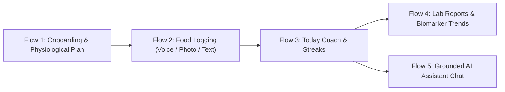
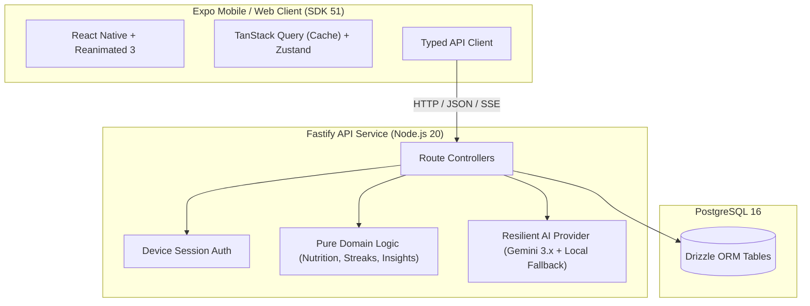

# Hale — Personal Health & Nutrition Assistant

> A production-grade, proactive personal health assistant designed to make nutritional logging effortless, connect blood biomarkers to daily diet habits, and coach users with empathetic clinical guidance.

[](https://github.com/Mritunjay004/Hale/actions/workflows/ci.yml)
[](https://www.typescriptlang.org/)
[](https://expo.dev/)
[](https://fastify.dev/)
[](https://www.postgresql.org/)

---

## 1. Problem & Product Thesis

### The Problem
Traditional calorie counters and fitness trackers fail because they demand unsustainable cognitive effort:
1. **High Interaction Friction:** Searching databases and weighing foods takes 3–5 minutes per meal, causing user burnout by Day 4.
2. **Numbers Without Meaning:** Showing "1,450 / 2,000 kcal" leaves users wondering what to actually do next.
3. **Disconnection from Underlying Biology:** Lab reports sit in filing cabinets while users track food in isolation, ignoring how diet directly drives biomarkers (like Vitamin D, HbA1c, and LDL).

### Hale's Solution
Hale is built as a **proactive assistant**, not a passive ledger:
- **< 10-Second Food Logging:** Multi-modal logging (Voice audio, Plate photos, Quick text) with Indian portion awareness (*katoris*, *rotis*, *bowls*).
- **Proactive "Next Best Action":** A single prioritized card tells you the one actionable thing to do now and why (e.g. *"Lunch not logged yet"* at 1 PM; *"+25g protein at dinner"* at 6 PM).
- **Biomarker to Habit Loop:** Lab documents are extracted in-memory to discover flagged biomarkers (e.g. low Vitamin D, elevated LDL) and instantly suggest evidence-backed nutrition habits.
- **Kind Clinical Guardrails:** Pushback on aggressive deficit targets (> 1 kg/week) and extreme calorie floors (< 1,200 kcal) to protect resting metabolism.

---

## 2. Core Product Flows



### Flow 1: Interactive Onboarding & Plan Engine
- 5-screen interactive progression with live Metric $\leftrightarrow$ Imperial toggle.
- Mifflin-St Jeor BMR calculation with activity multipliers.
- **Pushback Engine:** Detects unsafe paces (> 1.0 kg/week) and presents kind, clinical guidance for sustainable 300–500 kcal deficits.
- Generates **3 Personalized Focus Habits** pairing every target with its physiological "WHY".

### Flow 2: Multi-Modal Food Logging
- **Voice:** Speak your meal in natural language (e.g. *"Two rotis with yellow toor dal and a bowl of curd"*).
- **Camera:** Photograph your plate; multimodal vision identifies portions and estimates macros.
- **Quick Text:** 1-line description with intelligent regional unit parsing.
- **Confirmation Sheet:** Interactive quantity steppers, swipe-to-delete items, and live macro recalculation before idempotent saving.

### Flow 3: Today Screen — The Proactive Coach & Daily Meal Tracker
- **Meal Slot Tracker & Indicator:** Visual 3-segment progress bar tracking Breakfast, Lunch, Dinner, and Snacks with dynamic states (*Logged ✓*, *Due Now*, *Missing/Backfill*, *Upcoming*).
- **Smart Local Push Notifications:** Scheduled on-device reminders via `expo-notifications` (10:00 AM Breakfast, 2:00 PM Lunch, 8:30 PM Dinner, 9:45 PM Streak Guard) with automatic cancellation upon logging and deep-link tap handling.
- **Calorie & Macro Progress Rings:** Custom SVG circular ring animated with Reanimated 3 spring physics.
- **Human Microcopy:** Numbers paired with meaning (*"38g protein to go"*, not abstract math).
- **Vitality Insight of the Day:** Explains real-world subjective feeling (e.g. how low Vitamin D causes 3 PM energy slumps, fiber meal boosts).
- **Meal Timeline:** Chronological logged meals with item breakdown and Gestures 2.0 swipe-to-delete.
- **Streak & Grace System:** Tracks streaks with **1 automatic grace day per week** + 6 Milestone Achievement Badges + End-of-Day Summary modal.

### Flow 4: Health Reports & Biomarker Trend Engine
- **In-Memory Clinical Extraction:** Processes PDFs or camera photos in-memory without storing raw health documents server-side.
- **Visual Range Bars:** Horizontal clinical range indicator highlighting Normal vs Elevated/Low zones with option to manage findings.
- **Historical Trends:** Tracks changes over time across multiple tests (e.g. LDL down from 142 to 132 mg/dL).
- **Goal-Linked Habit Suggestions:** Flagged parameters automatically generate targeted focus habits.

### Flow 5: Grounded AI Coach Chat & High-Performance Virtualization
- **High-Performance Virtualization:** Virtualized `FlatList` with memoized chat bubbles and tool cards for zero input keystroke lag.
- **Interruptible Thinking & Stop Stream:** Instant abort controller capability with inline `✕ Stop` action.
- **Deeply Grounded Context:** The coach has full live awareness of the user's calorie targets, today's eaten totals, remaining macro gap, and flagged lab markers.
- **3 Native Tools:**
  1. `log_meal`: Directly logs food mentioned in conversation and refreshes Today rings.
  2. `explain_biomarker`: Clinical explanations with subjective energy/vitality connections.
  3. `suggest_meal`: Personalized dinner and lunch recipes matching remaining macros.
- **Safety Layer:** Clinical calorie floors and medical emergency disclaimers.

---

## 3. Architecture & System Design



### Monorepo Structure
```
hale/
├── apps/
│   ├── mobile/         # Expo SDK 51 (React Native + Web)
│   │   ├── app/        # expo-router file routes (Today, Chat, Reports, Onboarding)
│   │   └── src/        # Features (food-log, today, reports, chat), UI primitives, theme
│   └── api/            # Fastify backend service
│       ├── src/
│       │   ├── modules/# Route handlers (sessions, profile, meals, today, reports, chat)
│       │   ├── domain/ # PURE logic (BMR, macros, streaks, insight rules)
│       │   ├── ai/     # Gemini provider + resilient offline engine
│       │   └── infra/  # DB connection, schema, errors, auth
├── packages/
│   └── shared/         # Zod schemas, TypeScript types, 25-biomarker dictionary
├── docs/               # ADRs (001-006), product brief, build plan
└── docker-compose.yml  # 1-command PostgreSQL setup
```

### Layering & SOLID Principles
1. **Controller $\rightarrow$ Service $\rightarrow$ Repository:** Clear boundary enforcement; no database calls inside HTTP handlers.
2. **Pure Domain Logic:** Calorie/macro math, pushback checks, and streak grace calculations have **zero framework or I/O imports** for instantaneous unit testing.
3. **Dependency Inversion for AI:** Providers implement `LLMProvider` and `VisionProvider` interfaces. A `ResilientAIProvider` decorator catches rate limits (429/402) and falls back to a deterministic offline engine.
4. **Privacy by Design:** Raw medical photos and blood test PDFs are processed strictly in-memory. Only extracted structured parameters are persisted.

---

## 4. Tech Stack

- **Mobile / Web:** Expo SDK 51, React Native 0.74, `expo-router` v3, TypeScript strict.
- **Smart Push Notifications:** `expo-notifications` scheduled local on-device nudges with dynamic auto-cancellation upon meal logging.
- **UI & Iconography:** Handcrafted SVG vector icons with optical centering, Apple HIG dual-state navigation, active pill indicator, and 4pt token scale.
- **Animation & Gestures:** `react-native-reanimated` v3 (UI-thread worklets & spring physics per ADR-006), `react-native-gesture-handler` (Gestures 2.0).
- **Backend:** Node.js 20, Fastify v4, Drizzle ORM, PostgreSQL 16.
- **Validation & Contracts:** Zod shared across client and server.
- **AI Models:** Google Gemini 3.x Flash Multimodal (`gemini-3.8-flash`) with resilient local fallback.

---

## 5. Getting Started (One-Command Setup)

### Prerequisites
- Node.js $\ge$ 20.0
- Docker & Docker Compose (or local PostgreSQL)

### 1. Clone & Install
```bash
git clone https://github.com/Mritunjay004/Hale.git
cd Hale
npm install
```

### 2. Start PostgreSQL
```bash
docker compose up -d
```
*(Runs PostgreSQL on `localhost:5432` with database `hale_dev`)*

### 3. Configure Environment Variables
```bash
cp apps/api/.env.example apps/api/.env
```
*(Optionally add your `GEMINI_API_KEY`. If left blank or depleted, Hale automatically uses the built-in resilient local engine without breaking any flow).*

### 4. Build Shared Package & Run Dev
```bash
npm run build
npm run dev
```
- **API Server:** Listening on `http://localhost:3001`
- **Mobile / Web Client:** Open `http://localhost:8081` in your browser, or scan the QR code using Expo Go on Android / iOS.

---

## 6. Reviewer Demo Mode (Instant Evaluation)

Reviewers do not need to wait 14 days to see streaks, milestone badges, or lab trends:
1. Launch the app (Mobile or Web).
2. Tap **"Try with sample data"** on the onboarding screen or Today screen.
3. Instantly seeds:
   - A complete 78.4 kg profile with fat loss targets.
   - **14 days of realistic meal logs** with portion breakdowns (oats, rotis, toor dal, curd).
   - Steady 3-point weight loss progress.
   - **2 historical lab reports** displaying biomarker trend lines for LDL Cholesterol, Fasting Glucose, Vitamin D, and HbA1c.
   - Active streak with grace day and unlocked milestone achievement badges.

---

## 7. Testing & Quality Verification

```bash
# Run unit test suite (BMR, macros, pushback, streaks, grace days)
npm run test

# Run full monorepo typecheck
npm run typecheck

# Verify zero forbidden terms
npm run check:names
```

---

## 8. Deliberate Scope Decisions

| Included | Deliberately Excluded | Rationale |
|---|---|---|
| **Multi-modal meal capture (Voice, Photo, Text)** | Wearables & Apple Health sync | Wearable sync introduces battery and permission friction; nutrition accounts for $\sim$80% of body composition change. |
| **Lab Biomarker $\leftrightarrow$ Habit Engine** | Social feeds & Community | Health tracking is personal and clinical. Social feeds incentivize vanity over consistency. |
| **Grounded AI Nutritional Coach** | Automated restrictive meal plans | Static meal plans have low real-world compliance; flexible guided choices build lifelong habits. |
| **Anonymous Device Sessions** | Forced Email / Password signup | Users should experience the full product value before creating accounts. |

---

## 9. License & Author

Built with ❤️ for the Personal Health Assistant evaluation.

