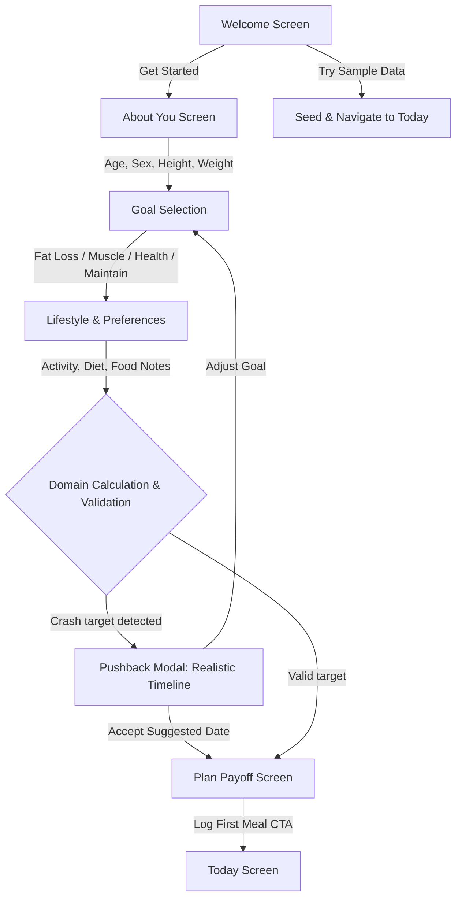
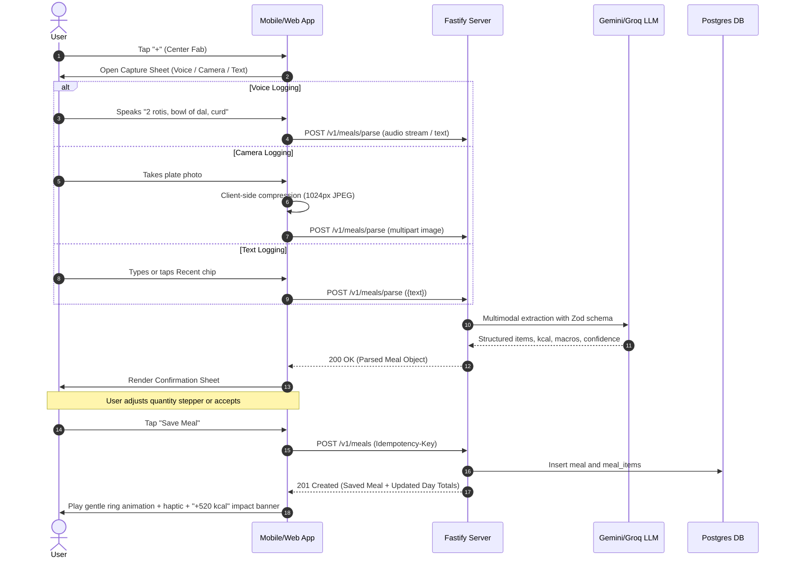
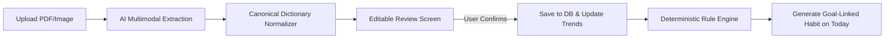

# Detailed User Flows & Architecture Specifications

This document specifies the five core user journeys of **Hale**, including step-by-step logic, state machines, edge cases, and acceptance criteria.

---

## Flow 1: Onboarding & Personalized Goal Plan (≤ 90 seconds)

### Overview
A progressive 5-screen intake that captures key physiological and lifestyle metrics, runs deterministic domain calculations (Mifflin-St Jeor BMR, TDEE, safe caloric deficit caps), enforces health guardrails (pushback on aggressive targets), and delivers a personalized plan with 3 focus habits.

### Flow Diagram



### Steps & Screen Specifications

1. **Step 1: Welcome (`/onboarding/welcome`)**
   - Headline: *"Your health assistant that does the work for you."*
   - Subhead: *"Natural meal logging, clear targets, and proactive guidance."*
   - Primary Action: `Get Started` button.
   - Secondary Link: `Try with sample data` (one-tap demo seed for reviewers).

2. **Step 2: About You (`/onboarding/about`)**
   - Fields: Age (years), Biological Sex (Male/Female), Height (cm or ft/in toggle), Weight (kg or lbs toggle).
   - Validation: Age 18–100 (if < 18, soft block to maintenance/healthy habits only); Height 100–250 cm; Weight 35–300 kg.

3. **Step 3: Goal (`/onboarding/goal`)**
   - 4 Goal Cards:
     - 🥗 *Lose Fat*: Sub-inputs for target weight (kg) and target timeframe (weeks/date).
     - 💪 *Build Muscle*: Sub-inputs for target surplus.
     - ⚖️ *Maintain*: Lock calorie target to TDEE.
     - 🌿 *Eat Healthier*: No weight target; focus on nutrient density, fiber, and consistency habits.

4. **Step 4: Lifestyle & Diet (`/onboarding/lifestyle`)**
   - Activity Level (4 plain-language cards):
     - *Sedentary* (Desk job, little intentional exercise) → 1.2x
     - *Lightly Active* (1–3 light walks or workouts/week) → 1.375x
     - *Moderately Active* (3–5 moderate workouts/week) → 1.55x
     - *Very Active* (Daily intense training or physical labor) → 1.725x
   - Dietary Preference chips: `Vegetarian`, `Non-Vegetarian`, `Vegan`, `Eggetarian`, `No Restrictions`.
   - Optional Notes chips: `Lactose Intolerant`, `Gluten Sensitive`, `Nut Allergy`, `Diabetic/Pre-diabetic`.

5. **Step 5: The Plan Payoff (`/onboarding/plan`)**
   - **Calorie & Macro Target Card**: Daily kcal, Protein (g), Carbs (g), Fat (g).
   - **The "WHY" Callout**:
     - Example: *"Your body burns ~2,150 kcal/day. A 400 kcal deficit creates a healthy ~0.4 kg/week weight loss pace that preserves muscle and metabolic health."*
   - **3 Focus Habits (WHAT, WHY, HOW MEASURED)**:
     1. *Hit ~95g protein daily* → **Why:** *"Protects lean muscle in a deficit so fat is lost, not muscle."* → **How:** Measured automatically from meals.
     2. *Log meals consistently* → **Why:** *"People who log meals consistently lose twice as much weight."* → **How:** Daily streak tracker.
     3. *Balanced Dinner* → **Why:** *"Keeping evening meals moderate supports sleep and metabolic recovery."* → **How:** Meal timing & calorie distribution.
   - Primary Action: `Start Logging Meals`.

### Domain Logic & Edge Cases

- **Mifflin-St Jeor Formula**:
  $$\text{BMR}_{\text{male}} = 10 \times \text{weight (kg)} + 6.25 \times \text{height (cm)} - 5 \times \text{age} + 5$$
  $$\text{BMR}_{\text{female}} = 10 \times \text{weight (kg)} + 6.25 \times \text{height (cm)} - 5 \times \text{age} - 161$$
- **TDEE**: $\text{BMR} \times \text{activity\_multiplier}$.
- **Safe Pace Enforcement (Pushback Rule)**:
  - Maximum deficit: 25% of TDEE or 1% of body weight per week.
  - Absolute floors: 1,200 kcal/day (female), 1,500 kcal/day (male).
  - If a user requests a target weight date that requires $> 1\text{ kg/week}$ loss:
    - The assistant pushes back with empathy: *"Reaching 65 kg in 4 weeks would require an unsafe crash diet of < 1,000 kcal. Let's aim for a sustainable pace of 0.4 kg/week reaching your goal in 12 weeks."*
    - Actions: `Accept Safe Plan` or `Adjust Target`.

---

## Flow 2: Effortless Food Logging (≤ 10 seconds)

### Overview
The hero flow of Hale. Allows logging in ≤ 10 seconds through voice, camera photo, or quick text. Feeds into an editable confirmation sheet that gives full control to the user before committing to storage.

### Sequence Diagram



### The Confirmation Sheet (Trust Moment)
- **Itemized List:** Each ingredient parsed with name, quantity, unit, kcal, and P/C/F macros.
- **Steppers:** Increment/decrement quantity with live total recalculation.
- **Confidence Badges:** Items with lower confidence receive a subtle `~ estimated` tag and a one-tap alternative switcher (e.g., `White Rice` ↔ `Brown Rice` ↔ `Biryani Rice`).
- **Meal Type Inference:** Automatically guesses Breakfast / Lunch / Snack / Dinner based on local device time, toggleable with one tap.
- **Skipped Meal Option:** Single tap to record *"Skipped breakfast"* (marks habit completion without calorie addition).

### States & Edge Cases
1. **Recording / Transcribing / Analyzing:** Rotating empathetic microcopy (*"Identifying dishes..."*, *"Calculating portions..."*), never a blank spinner.
2. **Silence / Empty Audio:** Friendly prompt: *"Didn't catch that. Tap to try again, or type your meal."*
3. **Non-Food Image:** Clear recovery: *"That doesn't look like food. Retake photo or type your meal."*
4. **Offline Mode:** If network is unavailable, saves directly to the local persistent mutation queue with a *"Will sync when online"* badge.
5. **Idempotency Protection:** UUID generated on sheet open prevents accidental duplicate meal submissions on double tap.

---

## Flow 3: Today (The Proactive Coach)

### Overview
The primary home screen. Rather than a static list or passive dashboard, Today acts as an active coach. It answers three questions in under 3 seconds:
1. *What should I do right now?*
2. *How is my balance today?*
3. *Am I making progress towards my long-term goal?*

### Screen Layout Hierarchy

```
┌────────────────────────────────────────────────────────┐
│  HALE           [Streak 🔥 4 days]  [Reviewer Mode ⚙️] │
├────────────────────────────────────────────────────────┤
│  ⚡ NEXT BEST ACTION CARD                              │
│  "Lunch not logged yet. Tap to log in 10s."            │
│  [ Primary Button: Log Lunch ]                         │
├────────────────────────────────────────────────────────┤
│  🎯 DAILY PROGRESS RINGS                               │
│  Calorie Ring: 1,420 / 1,850 kcal (430 remaining)      │
│  Macro Bars: Protein (65/95g) · Carbs · Fat           │
├────────────────────────────────────────────────────────┤
│  💡 INSIGHT OF THE DAY                                 │
│  "Protein is 30g short. Here are 3 quick evening ideas │
│  to protect muscle without exceeding your calorie gap."│
├────────────────────────────────────────────────────────┤
│  🍽 TODAY'S TIMELINE                                   │
│  08:30 AM  Breakfast: Oats, almonds, milk   380 kcal  │
│  01:15 PM  Lunch: 2 rotis, paneer, salad     520 kcal  │
├────────────────────────────────────────────────────────┤
│  📈 GOAL STRIP                                         │
│  Weight: 74.2 kg (Trending -0.3 kg/wk) [Check-in]      │
│  Focus Habits: [Protein ✅] [Daily Log 🔥] [Early Din] │
├────────────────────────────────────────────────────────┤
│  🩸 BIOMARKER SNAPSHOT                                 │
│  LDL Cholesterol: 132 mg/dL (Borderline)               │
│  Habit linked: "Swap 2 fried snacks for chana"         │
└────────────────────────────────────────────────────────┘
```

### Proactive Rules Engine (Next Best Action Priority)
1. **P0 (Critical check-in):** Weekly weigh-in due today → *"Weekly check-in: Log today's weight in 5 seconds."*
2. **P1 (Meal window missed):** Current time > 45m past user's typical lunch time and no lunch logged → *"Lunch not logged yet. Did you have your meal?"*
3. **P2 (Evening gap closure):** Dinner time approaching and protein is > 25g below target → *"You have 35g protein left today. Greek yogurt or eggs with dinner will close it."*
4. **P3 (Day Complete):** All meals logged and within target range → *"Day complete! Great balance today."*

---

## Flow 4: Health Reports → Tracked Parameters → Goal Habits

### Overview
Users upload a blood test report (PDF or image). Hale extracts clinical biomarkers, normalizes them against a 25-item canonical dictionary, displays an editable review sheet, plots historical trends, and links out-of-range parameters to daily focus habits.

### Pipeline Diagram



### Canonical Parameter Dictionary (25 Biomarkers)
- **Metabolic & Glycemic:** Fasting Blood Glucose, HbA1c, Insulin.
- **Lipid Panel:** Total Cholesterol, LDL Cholesterol, HDL Cholesterol, Triglycerides, VLDL.
- **Vitamins & Minerals:** Vitamin D (25-OH), Vitamin B12, Serum Ferritin, Iron, Calcium.
- **Liver Function:** SGOT/AST, SGPT/ALT, Alkaline Phosphatase, Bilirubin.
- **Kidney & Renal:** Serum Creatinine, Blood Urea Nitrogen (BUN), Uric Acid, eGFR.
- **Thyroid & Hematology:** TSH, Free T4, Hemoglobin.

### Parameter Detail & Safety
- **Visual Range Bar:** Visualizes the user's value inside or outside the reference range (`Low` | `Normal` | `High`).
- **Historical Sparkline / Trend:** Displays current and past report data points.
- **Safety Copy:** Strictly avoids medical diagnoses:
  - *"Your LDL is above standard clinical reference ranges. High LDL can be influenced by saturated fats and lifestyle factors. Discuss this with your physician. In your daily plan, we've enabled a habit to track and reduce saturated fats."*

---

## Flow 5: Context-Aware Chat Assistant

### Overview
A streaming, grounded AI assistant that answers questions, analyzes diet patterns, and takes direct actions using 3 structured tools.

### Injected Server Context
Every user turn is injected server-side with:
1. User profile (age, sex, height, weight, goal, calorie & macro targets).
2. Today's cumulative nutrition totals and meal timeline.
3. 7-day average calorie deficit and protein adherence.
4. Active focus habits and flagged biomarker values from reports.

### Tools Available to Assistant
1. `log_meal(text: string)`: Parses and presents the Flow 2 confirmation sheet inside the chat thread.
2. `get_summary(days: number)`: Fetches aggregate nutrition stats for 1 to 30 days.
3. `get_report_parameters()`: Retrieves the latest flagged biomarker status.

### Safety Guardrails
- **No Medical Diagnoses or Prescriptions:** Instantly deflects diagnosis questions to licensed medical professionals.
- **Calorie Floor Enforcement:** Never recommends a daily caloric intake below 1,200 kcal (women) or 1,500 kcal (men).
- **Disordered Eating & Mental Health Guardrails:** If restrictive or purging behaviors are detected, responds with warmth, refrains from giving deficit advice, and provides health support resources.
- **Domain Focus:** Politely redirects non-health/nutrition inquiries back to health coaching.

